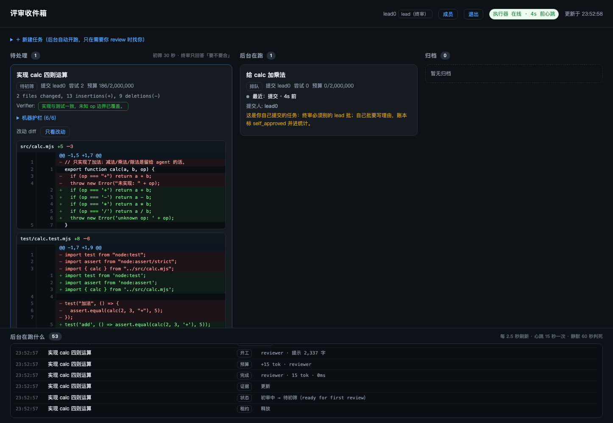
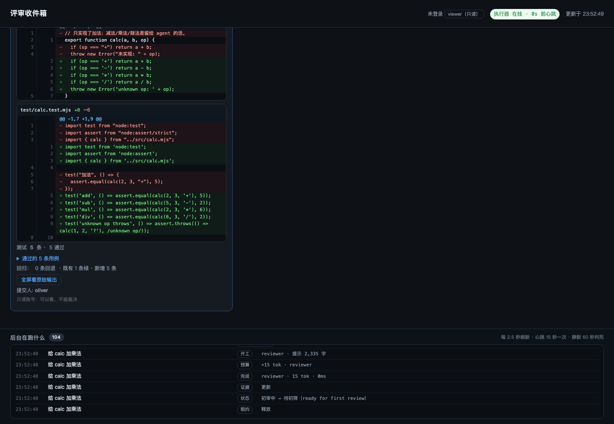
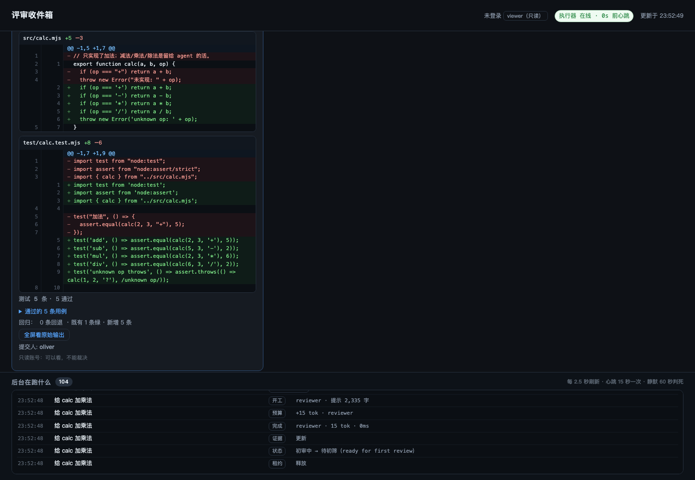
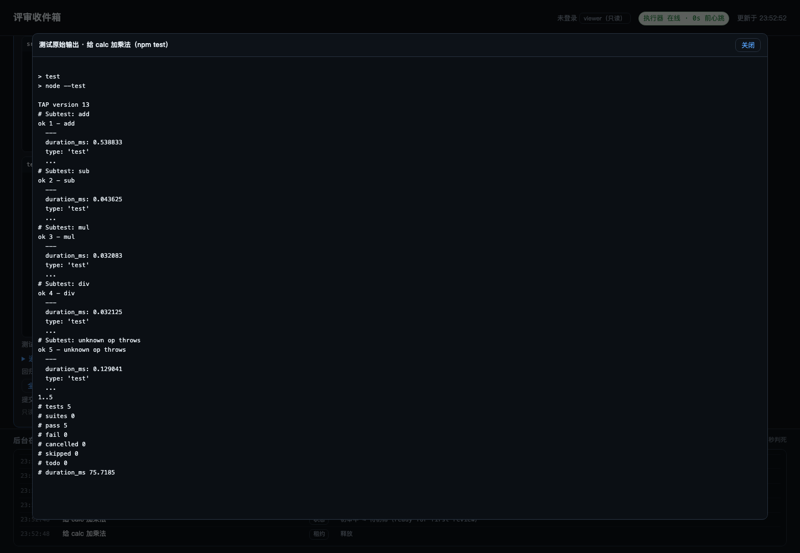

# 工作台 (Workbench) · Web 版

一个「AI 团队分工写代码、人只负责 review」的后台执行器。
你提交任务 → 后台自动 规划/实现/验收/复核 → 卡在两段人工：`awaiting_review`（初筛：这件事做对了吗）与 `awaiting_approval`（终审：要不要合）→ 你说合或不合。

人只回答一个问题：**要不要合**。其余全部自动重试、自动升级、自动归档。

形态：**一台机器当 runner**（一个常驻进程），其他人用浏览器打开它 —— 不用装 app，也不用碰终端。加人就是加账号，提交、初筛、批准都在浏览器里完成。

> 仓库分工：这个仓库只有 **Web 版**（内核 + 服务端 + 浏览器界面）。macOS 桌面版（Swift 外壳，把同一套内核打包进 .app）在 [noOne-Oliver/workbench](https://github.com/noOne-Oliver/workbench)。两边**不共享任何文件**：这里不构建 app、不打包、不提 .app。

## 起起来

第一次先建工作区（账本 + worktree 目录 + 起始仓库 `demo/`，幂等，重复跑不会覆盖已有内容）：

```bash
node src/cli.mjs workspace --dir ~/Workbench
```

然后一条命令起整套（server + 看护着的 worker；worker 崩了按 1s→2s→4s…封顶 30s 退避自动拉起）：

```bash
WB_ROOT=~/Workbench node src/cli.mjs up      # → http://127.0.0.1:7317
```

第一次启动会建一个 `lead` 账号并在终端打印一次性口令 —— 用它登录，然后在页面右上角「成员」里加人。

要常驻（关掉终端也不停），交给 launchd / systemd 拉起同一条命令：

```bash
launchctl submit -l local.workbench.kernel -- /bin/bash scripts/run-kernel.sh
```

`GET /api/health` 告诉你执行器是不是还活着（免登录，只有 pid / 心跳 / 版本，不吐任务内容）。

页面上方「＋ 新建任务」直接建任务：填一句话、目标仓库、token 预算，提交就走 `POST /api/tasks`，worker 自动开跑，到初筛/终审时才找你。

## 30 秒跑起来（本地演示，假引擎，不花钱）

```bash
npm run init                 # 建账本 + 初始化 demo 仓库
npm run enqueue -- --title "实现 calc 四则运算" --repo ./sandbox/demo
npm run worker               # 另一个终端：后台一直跑（也可 --once 跑一轮）
npm run serve                # 打开 http://127.0.0.1:7317 审阅
```

默认引擎是 `mock`（确定性假引擎，用来验证流水线与护栏），不需要任何 API key、不花钱。


## 它凭什么能无人值守

五个「不信任模型」的设计，缺一个就会退化成值班员：

| 机制 | 解决的问题 | 落点 |
| --- | --- | --- |
| **事件账本**（events 唯一真源，tasks 是物化投影） | 重启失忆、状态对不上 | `src/core/ledger.mjs` 的 `rebuild()`，kill -9 后从事件重放 |
| **租约**（单条 CAS UPDATE + pid 存活探测） | 两个 worker 抢同一个任务、死进程占着不放 | `src/core/lease.mjs` |
| **确定性护栏**（跑真测试、比对测试用例/断言数、查同义反复测试、diff 规模） | agent 改测试刷绿、空断言、**把实现抄成期望值**、顺手重构半个仓库 | `src/runner/guards.mjs` |
| **角色分离**（Verifier 拿不到 coder 的内心独白，只给 diff+真实测试输出+护栏结论） | 自己批自己的作业 | `src/runner/sop.mjs` |

「测试跑绿 ≠ 改对了」这件事，是护栏里的 `no_test_weakening` 与 `no_tautological_test` 兜住的，不是模型自评：

- **削弱测试**：删文件、用例数/断言数变少 → 打回。
- **同义反复**：实现是 `return Math.pow(a,b)`，测试写 `assert.equal(pow(2,0.5), Math.pow(2,0.5))` —— 永远绿，因为它校验的是"实现等于实现"。
  这条是真实基准跑出来的：Verifier 靠判断发现了它，现在下沉成确定性检查（`src/runner/guards.mjs` 的 `tautologyIn`），不再依赖模型有没有注意到。

伪绿会被自动打回重做，重试到上限才升级给人。重试这条路踩过两个坑，都已经堵上：

- **不喂证据 = 无脑重试**：现在把上一轮失败的护栏 id、证据原文、Verifier 上抛点一起写进 Coder 的提示词（`retryFeedback`）。
- **不重置 worktree = 假装重试**：第二次进入 `implementing` 时先 `git reset --hard` 回基线（`resetToBase`）。
  不重置的话 Coder 看到的是上一轮已经写好的代码，会"发现活干完了"，产出逐字节相同的 diff，白烧一整轮 token——真实基准里就是这么翻的车。
- **预算要给验证留钱**：实现花 18 万写完、账上没钱再跑 Verifier，等于把钱和活一起扔掉。现在进实现前先检查余量（`reserveShort`，默认留 25% 或 15 万 token）。

## 状态机

```
queued → planning → implementing → verifying → reviewing → awaiting_human → merging → done
              ↑           │            │            │              │           │
              └───────────┴────────────┴────────────┘              │           │
                         （自动重试，最多 3 轮）        blocked ←────┘           │
                                                          └── failed ───────────┘
```

- 只有 `awaiting_human` 会停住等人，且只有任务的 `owner` 能裁决（多人协作时防止「以为别人在看」）。
- `blocked` 是「机器认输了」：重试耗尽或预算超限，等人捞。

## 命令

```bash
node src/cli.mjs init                              # 建库 + 建 demo 仓库
node src/cli.mjs workspace [--dir ~/Workbench]     # 建一个工作区（data/ worktrees/ .oc/ + 起始仓库 demo/），幂等
node src/cli.mjs enqueue --title "..." --repo <dir> [--owner <name>] [--budget 1000000]
node src/cli.mjs status [--id <task>]              # 看任务与事件流
node src/cli.mjs rebuild                           # 从事件全量重建投影（自愈）
node src/cli.mjs run [--once] [--worker host:pid]  # 跑 worker
node src/cli.mjs serve [--port 7317]               # 只起审阅服务
node src/cli.mjs up                                # 起整套（server + 看护着的 worker，worker 崩了自动拉起）
npm run web                                        # Web 版：起 server + worker（见「Web 版」一节）
npm run web:status | web:logs | web:stop           # 看/跟/停
npm run demo:reset                                 # 把 sandbox/demo 恢复到种子状态
npm test                                           # 内核测试（状态机/账本/租约/预算/护栏/回归基线/登录）
```

## 环境变量

| 变量 | 默认 | 说明 |
| --- | --- | --- |
| `WB_ENGINE` | `mock` | `mock` 假引擎；`opencode` 真引擎（调本机 opencode CLI） |
| `WB_DB` | `data/ledger.db` | 账本路径 |
| `WB_TOKEN` | 空 | 脚本通道：设了就要带 `Authorization: Bearer <token>`（记 `by=cli`），浏览器仍走名字+口令 |
| `WB_PORT` / `WB_HOST` | `7317` / `127.0.0.1` | 服务监听（多人用时改 `0.0.0.0`） |
| `WB_MAX_ATTEMPTS` | `3` | 自动重试上限，超过转 `blocked` |
| `WB_MOCK_DELAY` | `0` | mock 每步延迟，用来模拟慢任务/演示并发 |
| `WB_MOCK_SCENARIO` | `fakegreen` | mock 场景：`fakegreen` 第一轮故意刷绿、`good` 一次过 |
| `WB_MODEL` | 空 | opencode 用的模型 |
| `WB_OC_HOME` | `./.oc` | opencode 的 XDG 数据目录（见下节：它必须能写，否则直接崩） |
| `WB_BUDGET` | `1000000` | 单任务 token 预算；真引擎一个任务约 36–48 万，20 万会中途熔断 |
| `WB_ROOT` | 当前目录 | **数据根**：账本、worktree、起始仓库都在它下面 |
| `WB_CODE` | 同 `WB_ROOT` | **代码根**：`web/` 从 `WB_CODE/web` 取。默认与数据根相同；把内核放在别处（只读挂载、容器镜像）时才需要分开 |
| `WB_WORKSPACE` | 空 | app 用：工作区目录（优先级最高，压过 UserDefaults 里存的选择） |
| `WB_NO_NPM` | 空 | 设成 1 强制让护栏走 `node --test`，用来复现「机器上没有 npm」的退路 |
| `WB_HEARTBEAT_MS` | `15000` | 每跑一个 agent 多久落一次心跳（`agent.heartbeat`），界面靠它显示「已跑 1m23s」 |
| `WB_SILENT_MS` | `60000` | 多久没有事件就判「worker 可能已停」并在卡片上报警 |
| `WB_NO_BASELINE` | 空 | 设成 1 关掉回归基线对比（没有 git 历史时用），此时 `no_regression` 只验证当前全绿 |
| `WB_WORKER_BEAT_MS` | `5000` | worker 心跳写文件的间隔；界面靠它判「执行器在线/断线」 |
| `WB_WORKER_STALE_MS` | `20000` | 心跳超过多久算断线（徽章变红「任务不会推进」） |
| `WB_PARENT_PID` | 空 | app 注入：内核发现 `ppid` 不是它就自己收工。防 `kill -9` 之后留下孤儿内核（手动起时不用设） |

## 五条验收怎么复现

1. **人工决策中位耗时 < 5 分钟** —— 卡片上直接给 diff / 护栏明细 / Verifier 结论 / 上抛问题，`review_seconds` 落库统计。
2. **照妖镜**：`npm test` 里「护栏：伪绿…」用例即此项；真管线里第一轮会被 `no_test_weakening` 打回。
3. **kill -9 自愈**：跑 `npm run worker` 中途 `kill -9`，再跑 `node src/cli.mjs run --once`，任务从断点续跑且不重复烧重试额度（事件流会出现 `attempt.resumed`）。
4. **并发**：两个 worker 起在同一账本上，同一个任务只会有一次 `lease.acquired`；不同任务各自独立 git worktree。
5. **预算熔断**：`--budget 10` 入队，跑一轮即 `blocked`，不会再花 token。

## 真引擎（方案 1）

`WB_ENGINE=opencode` 时，每个角色都起一次独立的 `opencode run`（不 `--continue`），
所以 Verifier 天然拿不到 Coder 的上下文——角色分离不是靠提示词约束，是靠进程隔离。

2026-11-18 在本机实测踩到的三个坑，provider 里已经全部兜住（`src/runner/providers/opencode.mjs`）：

| 坑 | 现象 | 兜法 |
| --- | --- | --- |
| 要写 `~/.local/share/opencode` | `attempt to write a readonly database`，沙箱里必崩 | 把 `XDG_DATA_HOME/CACHE/STATE` 指到工作区内的 `WB_OC_HOME`（默认 `./.oc`） |
| 报错时**不退出** | 实测挂 13 分钟、stdout 0 字节，stdout 一个字的错误都不给 | 盯它自己的日志文件（`${XDG_DATA_HOME}/opencode/log/*.log`），命中限流/额度/鉴权字样立刻 SIGKILL |
| 空产出但 exit 0 | 看起来"干完了"，其实什么都没做 | 文本为空即判失败，绝不当成功 |

两个体检命令，都是几秒钟出结论：

```bash
# 1) 引擎能不能用（不能用时直接告诉你原因，不会挂在那儿）
WB_ENGINE=opencode WB_MODEL=<provider/model> node scripts/engine-smoke.mjs "只回复两个字 OK"

# 2) 真任务基准：失败率 / 耗时 / token / 重试次数，报告写到 docs/bench-*.json
WB_ENGINE=opencode WB_MODEL=<provider/model> node scripts/bench.mjs --fresh --tasks 3
```

基准用的是独立种子仓库 `.bench/repo`（不是 `sandbox/demo`），所以跑来跑去不会污染演示数据。

### 实测基准（2026-11-18，gpt-agent.cc + deepseek-v4.1-flash）

```
任务                       状态             尝试  token      秒  校验
slugify    awaiting_human      1   410511   110 pass
pow        awaiting_human      1   362124   201 pass
divzero    awaiting_human      1   477178   311 pass

成功率 1  到达人工审核 3/3  重试 0  总 token 1249813  墙钟 311s
```

三件事值得记住：

1. **一次过**：3/3 第一轮就过护栏 + Verifier，0 次重试，没有伪绿。照妖镜这次没被触发（不是没生效，是模型没作弊）。
2. **单任务 ≈ 36–48 万 token**（约 100 秒）。这是真引擎的成本量级，不是提示词里能省掉的：opencode 每次调用自带 2 万 token 的系统提示 + 工具往返。
   所以默认预算从 20 万提到了 **100 万**（`WB_BUDGET`）——20 万是 mock 时代的数，真任务会在跑到一半时熔断。
3. **Verifier 确实在判内容，不在判格式**：它自己上抛了「`pow` 的测试与实现同为 `Math.pow`，属同义反复」、
   「`calc(0,0,'/')` 现在也抛错，但数学上是 NaN」、「非 ASCII 字母会被当分隔符」——这三条都不是测试能测出来的。

人工闭环也验过：approve → `merging` → `git merge --no-ff` → `done`，demo 仓库出现合并提交 `wb: merge 实现 src/slug.mjs ...`。

### 真任务实测（2026-11-22，同模型）

在工作区 `/tmp/wb-real-ws` 里跑真引擎（凭据用 `cred import` 搬进工作区，不进仓库）：

```
任务                         状态             尝试 token     护栏    Verifier
实现乘法、除法与除零报错      awaiting_human    1   409738   5/5 绿  pass（raised 空）
diff: 3 files changed, 46 insertions(+)
```

这一轮撞上第四个坑，已兜住：

| 坑 | 现象 | 兜法 |
| --- | --- | --- |
| 规划阶段 cwd 在 `.oc/scratch`，agent 去读目标仓库属于「目录外」 | opencode 自动拒绝权限（`PermissionRejectedError`），整轮只剩工具调用、正文 0 字、退出码 0 → 被当成「空产出」重试，57 秒烧掉 22.5 万 token 才 blocked | ① 生成 `<WB_OC_HOME>/permission-overlay.json` 只读放行工作区根目录（`OPENCODE_CONFIG`，用户自设则不覆盖；`/tmp` 与 `/private/tmp` 两种写法都放行，bash 工具会解析 realpath）② 权限拒绝归类为**确定性失败**，直接 blocked 不再重试（`classifyFailure`）③ 失败时原始事件落盘 `<WB_OC_HOME>/logs/fail-*.jsonl`（留最近 5 个），不重跑也能对着看 |

判断「要不要重试」这件事本身也得有依据：同样是「没有正文」，权限拒绝重试一百次也一样，
限流/偶发空回才值得再给一次机会 —— 这个区分现在写在 `classifyFailure` 里，有单测（`tests/opencode-failure.test.mjs`）。

## 多人怎么用

一台机器当 runner，其他人用浏览器访问同一个后台执行器。想省事就用启动器（自动写 pid/日志/token 到 `<工作区>/.wb/`）：

```bash
npm run web                          # 默认 host 0.0.0.0、端口 7317、工作区 ~/Workbench
node scripts/workbench.mjs start --port 7317 --workspace ~/Workbench
```

```text
✓ 工作台已启动
  工作区  /Users/liujie/Workbench
  引擎    mock
  进程    server=54675 worker=54676
  日志    ~/Workbench/.wb/server.log · ~/Workbench/.wb/worker.log

  本机    http://127.0.0.1:7321/
  内网    http://192.168.31.35:7321/   （同一 Wi-Fi 下的人用这个）

  口令    w56kq48XgqHK2YlD-aXXXnhq
          首次启动生成，git 里没有；发给同事后自己留一份
```

### 一人一号与三种角色

v0 早期是「一个共享口令」——谁都能批任何事，等于没有身份。现在是**一人一号**：

| 角色 | 能做什么 | 不能做什么 |
| --- | --- | --- |
| member | 提交任务、领取初筛、打回自己领的任务 | 批准合并、改预算、加人 |
| lead | 上面全部，加终审批准合并、管理成员 | —— |
| viewer | 只看 | 一切写操作 |

- 口令用 `node:crypto` 的 scrypt 哈希存库（`scrypt$16384$8$1$salt$hash`），不存明文；登录态是 HMAC 签名的 cookie（7 天），**改口令或改角色会立刻踢掉旧会话**（`secret_version`）。
- 建人：`node src/cli.mjs user add --name alice --role member`（不给 `--password` 就生成一次性口令，只显示一次）；还有 `user passwd / user role / user disable / user enable / user list`。
- 首次启动一个能登录的账号都没有时，自动建一个 lead 并打印一次性口令——不会卡在「谁都能进」或「谁都进不来」。
- 历史账本里的 `owner` 会自动补成账号（锁住，等 lead 设口令），不用手工迁移。

`WB_TOKEN` 从「团队共用口令」降级成**脚本 break-glass**（curl/CI 用，记 `by=cli`）；浏览器走名字 + 口令。

### 两段评审（初筛 → 终审）

机器能证明「测试过了」，证明不了「这是不是你要的东西」。所以人这一关拆成两段，而且**两个状态是显式的**——账本重放一眼能看出卡在哪一关：

```text
implementing → verifying → awaiting_review   （成员初筛）
             → awaiting_approval              （lead 终审）
             → merging → done
```

- **初筛只回答三个问题**（30 秒）：做的是不是这件事 / 范围能不能接受 / 有没有遗留。不重复机器活（测试过没过是 Verifier 的事）。
- **领取制**：任何 member 都能领，领了锁 30 分钟（`WB_REVIEW_TTL_MS`），超时释放；不用定时任务，读的时候按时间判。
- **lead 也能直接初筛通过**，账本记 `waived`——小改动不必为流程空转。
- **自己提交自己批**：允许，但必须写理由，卡片标红、账本记 `self_approved`——统计得出来谁在给自己放水。
- **打回必须写理由**：原话进 `retryFeedback`，下一轮 coder 的 prompt 里第一句就是它（「优先级高于机器结论」）。
- 两段耗时分别记 `review_seconds` / `approval_seconds`：初筛打回率长期为 0，就说明这一关该砍。

```bash
# 端到端演示：alice 提交 → 机器跑 → bob 领取初筛 → lead0 批准 → 合并
node scripts/demo-review.mjs --fresh

# 界面证据：lead 同时看到「待初筛」和「待批准」两种卡，按钮就是权限矩阵
node scripts/shot-roles.mjs
```


### 真引擎整单（2026-11-22，两段评审，app 外进程）

mock 只能证明链路通，不能证明「真模型写的东西人愿意批」。这一单用真引擎（`gptagent/deepseek-v4.1-flash`）从提交跑到合并：

| 指标 | 值 |
| --- | --- |
| 任务 | `t_mwrszckr0xwnk`「给 calc 加乘法、除法与除零报错」 |
| 终态 | `done`（attempts=1，一次过） |
| token | 444,497 / 2,000,000 |
| 墙钟 | 111 秒（实现 + 验证 + 两段人工 + 合并） |
| 机器护栏 | 6/6 全绿（11 条用例真跑过，无回归、无削弱、无同义反复） |
| 改动 | 4 files changed, 55 insertions(+) |
| 初筛 / 终审 | 2s / 2s（人只花了 4 秒，因为证据包直接给了结论） |
| 合并提交 | `fbe16d8 wb: merge 给 calc 加乘法、除法与除零报错` |

```bash
# 整单：alice 提交 → 后台实现/验证 → bob 领取初筛 → lead0 批准 → 合并
WB_ENGINE=opencode WB_MODEL=gptagent/deepseek-v4.1-flash \
  node scripts/demo-real-review.mjs --fresh
# 报告：docs/real-review-<stamp>.json（护栏明细、用例清单、事件时间线）
```

真实产出（合并后仓库里的 `src/calc.mjs`，除零真的抛错，不是只写注释）：

```js
export function calc(a, b, op) {
  if (op === "+") return a + b;
  if (op === "*") return a * b;
  if (op === "/") {
    if (b === 0) throw new Error("除零错误: division by zero");
    return a / b;
  }
  throw new Error("未实现: " + op);
}
```


### 真引擎基准：5 单连跑（2026-11-22）

单跑一单只能证明「跑得通」，说明不了稳定性和成本。这个基准把 5 个独立小任务串起来跑（每个都走完两段评审 + 合并），量的是「日常用起来是什么感受」。

| 任务 | 一次过 | token | 机器耗时 | 改动 | 合并提交 |
| --- | --- | --- | --- | --- | --- |
| slugify | ✅ | 412,934 | 115s | 2 files, +31 −1 | `2b13eec` |
| median | ✅ | 438,804 | 113s | 2 files, +40 −1 | `097ab47` |
| range-bug | ✅ | 463,427 | 119s | 2 files, +8 | `d0788c2` |
| clamp | ✅ | 466,648 | 103s | 3 files, +44 | `5799125` |
| truncate | ✅ | 631,901 | 155s | 3 files, +84 | `6b22bc2` |

**5/5 一次过**（`attempts` 全是 1），总 **2,413,714 token**，平均 **482,743/单**，机器段 103~155 秒（平均 121 秒），5 单总墙钟 **605 秒**。合并后 main 上 `node --test` **33 个用例全绿**（7 → 13 → 14 → 20 → 33，说明每单的测试都真的合进去了）。

token 花在哪（账本 `budget.spent` 按角色聚合）：

| 角色 | token | 占比 |
| --- | --- | --- |
| lead（拆解） | 348,924 | 14.5% |
| architect（切片） | 337,670 | 14.0% |
| coder（写代码） | 860,737 | 35.7% |
| verifier（跑测试 + 裁决） | 371,902 | 15.4% |
| reviewer（合并前复核） | 494,481 | 20.5% |

```bash
npm run bench:real    # 需要 .oc 里的真凭据；报告写 docs/bench-real-<stamp>.json
npm run bench:real -- --tasks 2   # mock 也能跑，3 秒验完度量本身
```

**怎么读这几个数**：

1. **一个小函数的活要 48 万 token，其中 coder 只占 36%**。规划（lead + architect）加评审（reviewer）合计 49%，也就是「每个任务固定 5 次 agent 调用」的编排开销比写代码本身还贵。想省钱该先砍编排（小任务跳过 architect 出 slices、reviewer 复用 verifier 的结论），而不是继续磨 coder 的 prompt。
2. **成本随仓库变大而涨**：`truncate` 是第 5 单，63 万 token，是第 1 单的 1.5 倍——因为 coder 的上下文里测试文件和既有实现越来越多。这条线再涨下去，单任务预算是会撞墙的。
3. **5/5 一次过 ≠ 模型稳定**。这 5 个任务都有明确的验收标准、都在一个干净的绿field仓库里，属于「能力范围内」。难度上去（跨文件重构、要读文档、要装依赖）失败率一定上升，那时才轮到重试通道和证据包发挥作用。
4. **人工耗时这里是脚本代劳的 1 秒下限**（人没真读）。真读过一单的是 4 秒（见上一节）。真正该量的其实是「证据包够不够判断」，这个还没量化——下一步该找一个「模型做对了但人得看很久」的任务来测。

### 砍编排：小改动只花两次调用（2026-11-22 晚）

上一节的结论是「编排比写代码还贵」。这一节是执行结果：**每个任务固定 5 次 agent 调用 → 小改动固定 2 次**（coder + verifier），lead / architect / reviewer 全部跳过。

怎么判（`src/core/sizing.mjs`，确定性规则，不让模型自己声明）：

| 判据 | 体量 | 走哪几段 |
| --- | --- | --- |
| 标题含 重构 / 迁移 / 架构 / 设计文档 / 多个模块 / 批量 / 并发 / 安全 / 性能 / 协议 / 接口不兼容 | large | lead → architect → coder → verifier → reviewer |
| 仓库里被 git 跟踪的文件 > 40、或标题 > 120 字、或需求里点到多个源文件 | normal | coder → verifier → reviewer |
| 其余 | small | coder → verifier |

跳过要留痕：账本里落 `plan.skipped` / `review.skipped` 事件（带理由和判据），不是静默少跑一段——否则以后没人知道这里少了一道。

**省钱不能省第二次机会的质量**：small 只在 `attempts === 0` 走快路径。一旦被打回（人打回或护栏/Verifier 打回），重试自动降级 normal，拿到完整的拆解再动手——不然就是在省钱的名义下把重试额度烧在「连方案都没有」上。

同一个 5 单套件，改前改后：

| 任务 | 编排成本（旧） | 快路径（新） | 省 |
| --- | --- | --- | --- |
| slugify | 412,934 | 212,643 | 48.5% |
| median | 438,804 | 212,420 | 51.6% |
| range-bug | 463,427 | 238,872 | 48.5% |
| clamp | 466,648 | 264,167 | 43.4% |
| truncate | 631,901 | 225,049 | 64.4% |
| **平均** | **482,743** | **230,630** | **52.2%** |

5/5 仍然一次过、护栏 6/6 全绿、合并后 main 上 27 个用例全绿（6 → 11 → 15 → 20 → 27）；机器段 103~155 秒 → 39~57 秒，5 单总墙钟 605 秒 → 247 秒。token 只剩两个角色：coder 832,496（72%）、verifier 320,655（28%）。

报告 `docs/bench-real-2026-11-22T12-43-26-494Z.json`，复现：`npm run bench:real`。

**别读成「成本问题解决了」**：

1. 这一套 5 单现在**全部命中 small**，所以它证明的是「小改动省一半」；normal / large 的路径当时一次都没被真跑过（只有单元测试兜着）——下一节已经补上混跑。
2. 省钱来自「少调三次」，不是「调得更便宜」。单次调用还是 6~17 万 token（harness + 推理），再往下压只能继续减调用次数——下一个该问的是「Verifier 能不能和 Coder 合成一次」，但那等于让写代码的人自己判卷，我倾向于不换。
3. 快路径把方案责任推给了 Coder：没有上游拆解，它得一次想清接口形状。这次 5/5 能过是因为任务都有明确验收；换成「需求本身模糊」的小改动，跳过拆解可能反而多跑一轮，而一轮就是 21 万。所以这条规则该按「初筛打回率」持续校准，不是一劳永逸。

### 混着跑：small / normal / large + 一次确定性降级（2026-11-22 深夜）

上一节末尾留的作业是「normal / large 一次都没被真跑过」。这一轮把套件换成混跑，并且每单写死「该出现哪几个角色」，跑完自动对账——体量分级是确定性规则，跑错了就是代码错了，不能让报告里悄悄少一次 reviewer 还看着像成功。

| 任务 | 体量 | 角色序列 | 尝试 | token | 机器秒 |
| --- | --- | --- | --- | --- | --- |
| slugify | small | coder → verifier | 1 | 210,118 | 48 |
| median | small | coder → verifier | 1 | 212,781 | 46 |
| merge-utils | normal | lead → coder → verifier → reviewer | 1 | 417,776 | 97 |
| truncate-long | normal | lead → coder → verifier → reviewer | 1 | 611,112 | 172 |
| refactor-range | large | lead → architect → coder → verifier → reviewer | 1 | 622,392 | 186 |
| fastpath-retry | small | coder → verifier → lead → coder → verifier → reviewer | 2 | 829,423 | 205 |
| **合计 6 单** | — | 6/6 完成 | — | **2,903,602** | 墙钟 755 秒 |

按体量看每单成本：**small 约 21 万；normal 42~61 万；large 62 万**。normal 比 small 贵出来的正是 lead（出方案）和 reviewer（多一道判卷）——这两段买的是「多模块会踩到的边界」，不是浪费。token 按角色：coder 1,410,928（48.6%）、verifier 634,020（21.8%）、reviewer 454,476（15.7%）、lead 330,689（11.4%）、architect 73,489（2.5%）。平均 483,934/单、平均机器 126 秒。

降级路径这次真的跑到了：`fastpath-retry` 由脚本注入一条同义反复断言（期望值直接抄实现调用），第一次必然被 `no_tautological_test` 抓住 → 自动补方案（lead）→ 第二次通过，attempts=2，角色序列与预期一致。

#### 这一轮撞出来的三个真问题（都已封死）

1. **容器化靠不住**：coder 顺着 worktree 的 `.git` 找到主仓库，把测试文件写进了主仓库 → 主仓库变脏 → `git merge` 拒绝执行 → 任务卡在「等待批准」，人看到的只有一句 `merge conflict, needs human`。修法（`src/runner/worktree.mjs` + `worker.doImplement`）：coder 跑之前拍一次主仓库状态，跑完只还原「这次才变脏」的路径——**别人未提交的改动一个字都不碰**——并落 `workspace.restored` 事件与 `evidence.containment`。prompt 里也写死了「只改当前目录，主仓库不要写」。
2. **合并前不查主仓库干净**（`worker.doMerge`）：现在先看 `git status --porcelain`，脏就直接 `blocked` 并指名道姓列出文件（「先提交或清理这些改动，再重试合并」），不再让 git 甩黑话；状态机相应允许 `merging → blocked`。
3. **normal 之前还在跑 lead + architect**（README 写的是 coder → verifier → reviewer）、**快路径失败后重试拿不到方案**（规划段不会再跑）。已按 README 改：只有 large 才调 architect；`verifying` 失败且没有方案时回 `queued` 补方案（状态机加 `verifying → queued`）。

对账口径：重试会额外插进 coder → verifier 的对，所以只对「角色**首次出现**的顺序」对账；体量判错（normal 少一次 lead、small 多一次 architect、large 缺 architect）会立刻红。

复现：`WB_ENGINE=opencode WB_MODEL=gptagent/deepseek-v4.1-flash npm run bench:real -- --fresh --tasks 6`（约 13 分钟、约 290 万 token）。报告 `docs/bench-real-2026-11-22T13-25-24-476Z.json`。

**「一次过率 100%」别读成稳定**：这 6 单都还在模型能力范围内，失败率要拿「需求本身模糊」的活去跑才有意义；这套混跑证明的是**降级路径真的能走通**，不是「不会失败」。
### 进程管理

```bash
npm run web          # start（已在跑就只打印地址，不会起第二份）
npm run web:status   # 端口通不通、两个进程活着没、账本里各状态几个任务
npm run web:logs     # 看 server + worker 日志（--follow 跟到底）
npm run web:stop     # SIGTERM，8 秒不退再 SIGKILL
```

进程与状态都落在 `<工作区>/.wb/`（`server.pid`、`worker.pid`、两个 `.log`、`token`），所以重启机器后 `npm run web` 接着原来的账本跑。




### 和桌面版的关系

两个仓库、两套交付：桌面版把内核装进 `.app` 发给一个人用；这里把内核当服务跑起来，给一个团队用浏览器连。**内核是同一套逻辑，但代码不互相依赖** —— 桌面版将来要跟着升级，是它自己去取这个仓库的发布版，而不是两边各存一份源码。
### 安全边界（别踩）

- 默认是 **HTTP 明文 + 单口令**：只适合内网/同一 Wi-Fi。要出公网，请套 Tailscale 或 nginx + HTTPS 反代，别直接端口映射。
- 现在一人一号：审计看事件里的 `actor`，`review.claimed` / `review.passed` / `human.decision` 分别记领取人、初筛人、批准人。`WB_TOKEN` 只是脚本通道（记 `by=cli`），别发给人。
- 工作区里的 `.oc/private/provider.env` 是真模型凭据，别把工作区目录共享出去。
- **静态文件按路径段校验**（`src/server/index.mjs` 的 `resolveStatic`）：判断依据是 `relative(WEB, file)` 不以 `..` 开头，不是 `startsWith(WEB)` —— 后者会把 `web-secret` 这种兄弟目录当成"在 web 里面"。
- **登录有退避**：同一个人名连错 5 次锁 60 秒，之后每次翻倍、封顶 10 分钟（第 6 次回 429 + `Retry-After`，锁住期间正确口令也不放行）。计数在内存里，重启即清空、多实例不共享——挡的是在线爆破，不是分布式撞库。
- **前端不拼内联 `onclick`**：用户名只进 `data-*`，点击走事件委托。`onclick="f('名字')"` 只要名字里有个单引号就能跳出字符串。
- 明确的缺口：没有 CSRF token（靠 `SameSite=Lax`）、没有 HTTPS、没有 2FA。这些的前提都是"先套反代"，不是本项目内部该解决的。

## 重试闭环（护栏 FAIL → 打回 → 重做 → 通过）

「能自动执行」的核心不是模型一次写对，而是**写错了能不能自己回来**。`scripts/demo-retry.mjs` 就是这条链路的自动化验收：给 coder 加一层 `WB_FAULT=tautology` 的故障注入（`src/runner/providers/faulty.mjs`），在 **attempt 0** 把 `assert.equal(calc(2,3,'+'), 5)` 改写成 `assert.equal(calc(2,3,'+'), calc(2,3,'+'))`，然后看护栏能不能抓住、系统能不能自己重做。

```bash
# mock 版（4 秒，验证链路本身）
WB_ENGINE=mock WB_MOCK_SCENARIO=good WB_FAULT=tautology node scripts/demo-retry.mjs --fresh

# 真引擎版（2 分钟，验证真实模型 + 真实 token）
WB_ENGINE=opencode WB_MODEL=gptagent/deepseek-v4.1-flash \
  WB_FAULT=tautology WB_BUDGET=2500000 node scripts/demo-retry.mjs --fresh
```

实跑输出（2026-11-22，真引擎）：

```
[fault] attempt 0 注入同义反复测试: test/calc.test.mjs×7
attempt.started #1                      coder    121468 token
verify FAIL  no_tautological_test:      verifier  47895 token
  test/calc.test.mjs:5 断言的期望值与实际值完全一样: calc(2, 3, '+')
task.transition verifying -> implementing (verify failed: no_tautological_test)
attempt.started #2（已 git reset 回基线）coder    124851 token
verify PASS 全绿                        verifier  47988 token
终态=awaiting_human attempts=2 spent=534379
链路成立：FAIL → 打回 → 重置 → 重做 → 通过 → awaiting_human
```

这条演示在写的时候**真的抓出一个假绿**：`src/runner/guards.mjs` 过去只有在实现函数里存在"调用"（`Math.pow`、同文件辅助函数）时才检查同义反复；实现只用运算符（`a + b`、`a ** b`）时检查直接短路，`assert.equal(f(x), f(x))` 这种恒真断言完全逃过去。现在「两边是同一表达式」这条判据被提到与实现无关的位置（`sameExpression()`），实现只剩运算符也照抓。回归用例见 `tests/guards-tautology.test.mjs` 最后一条。

## 后台在跑什么（实时活动流）

「人只负责 review」有个隐藏前提：**你得看得见它在干活**。状态徽章只告诉你「实现中」，分不清「模型在思考」和「worker 进程已经死了」——那又变成值班员了。所以每一次 agent 调用都要留下开工、心跳、收工三条记录：

| 事件 | 何时落 | 带什么 |
| --- | --- | --- |
| `agent.started` | 每次 `provider.run` 之前 | `role`、`attempt`、`prompt_chars` |
| `agent.heartbeat` | 每 `WB_HEARTBEAT_MS`（默认 15s） | `role`、`elapsed_s`（只用来证明还活着，界面不逐条刷屏） |
| `agent.finished` | 无论成功/抛错/超时都落 | `role`、`ok`、`tokens`、`ms`、`error` |

这三条 `apply=false`（不进状态投影，重放时不会改变任务状态），只喂给 `/api/activity`：

```bash
curl -s '127.0.0.1:7317/api/activity?limit=20' | jq '{cursor, live, events: [.events[] | {type, ts: .ts[11:19]}]}'
# live: 正在跑的任务此刻在哪个角色、已跑多久、静默了多少秒（超 WB_SILENT_MS 判 stalled）
# since=<cursor> 只取增量，界面每 2.5 秒拉一次，不重绘整页
```

界面是常驻底部的一条「后台在跑什么」：事件流 + 每张卡片上的一句「**coder** 正在跑 · 已 1m23s」。静默超时就把那句话换成红色「⚠ 90s 无事件，worker 可能已停」。点卡片上的「看时间线」只看这个任务。



实跑（mock，`WB_MOCK_DELAY=20000` 让 coder 慢下来好截图）：`live={"role":"coder","state":"implementing","elapsed_s":9,"silent_s":3,"stalled":false}`，同屏事件 `attempt.started → agent.started → agent.heartbeat → budget.spent → agent.finished`，回归用例见 `tests/activity.test.mjs`（4 条，含「心跳不打断计时」「120 秒后 stalled=true」）。

## Review 界面：测试清单、回归基线、看得懂的 diff

用户原话（`m01493`）：「测试输出的时候 我没有办法稳定 用鼠标滚轮完全看完所有 测试用例，而且编排不太容易看出来哪里 修改了，我这么改对不对，而且是不是也会跑回归测试去做验证?」——三个问题对应三处改动。

### 1) 滚轮能到底

旧 CSS 把测试输出塞进 `pre { max-height: 220px; overflow: auto }`，而这个 `pre` 又在一层可滚动的 `main` 里：双滚动条，滚轮划到内层就卡住，长输出根本看不完。现在卡片里的 diff / 用例都是普通文档流，**页面只有一层滚动**；「全屏看原始输出」开的是原生 `<dialog>`（`92vw × 88vh`，`pre` 高度 `calc(88vh - 46px)` 且 `max-height: none`），滚轮一条道到底。

### 2) 看得出改了哪

diff 从「一整段带颜色的文本」改成按文件分组 + 双列行号：

- `diffSection()` 以 `diff --git` 切文件，每个文件一个 `<details>`，标题是文件名 + `+N −M`（`+0 −0` 时显示「只有上下文，没改动」）
- 每行 grid 三列：**旧行号 | 新行号 | 内容**，行首标 `+` / `−` / `@@`
- 「只看改动」一键隐藏 `@@` 上下文行（`.dlines.only .dlrow.c { display: none }`），只留增删行

### 3) 真跑回归

`tests_pass` 回答「当前代码全绿吗」，`no_regression` 回答「跟 base 提交比，有没有原来绿的变红」。后者：`git -C <worktree> archive <base> | tar -x -C <tmpdir>` 把 base 的树展开到临时目录，用**同一条测试命令**再跑一遍，两边 `parseTestCases()` 解析出用例名单后 `compareBaseline()` 对比。

| 结论 | 含义 |
| --- | --- |
| `regressions` | base 过、现在挂 → 直接 FAIL，detail 列「原来能过的用例现在挂了: …」 |
| `fixed` | base 挂、现在过 |
| `added` / `removed` | 新增 / 删掉的用例 |
| 基线本身不绿 | base 里就有 N 条本就挂 → 不算这次回退，detail 如实写「基线本身有 N 条本就失败」 |

`WB_NO_BASELINE=1` 关掉基线（没有 git 历史时用），此时 detail 写「没有取到基线…本次只验证当前全绿」，不假装验证过。

**这次抓到的假绿**：从 `node --test` 里再 `spawn` 一个 `node --test`，子进程会继承 `NODE_TEST_CONTEXT=child-v8`，于是它**直接退出 0**——失败用例被当成通过，基线永远全绿。修法是在 `runSuite()` 里先 `delete env.NODE_TEST_CONTEXT`（`src/runner/guards.mjs`）。用例见 `tests/regression.test.mjs`。

实跑（mock，任务 `t_mwrrl0tu0n1kc`，attempts=2）：

```json
testCases {"total":5,"pass":5,"fail":0,"names":["+add","+sub","+mul","+div","+unknown op throws"]}
baseline  {"ok":false,"pass":0,"fail":4,"regressions":[],"fixed":["add","sub","mul","div"],"added":["unknown op throws"]}
```

（`sandbox/demo` 的 base 是桩代码，4 条用例本来就挂，所以是 `fixed=4` 而不是 `regressions`。）





## 执行器崩了会自己起来（2026-11-22 事故复盘）

这一节是给「无人值守」补的最后一块：**任务失败有人兜，执行器死了没人知道**，才是最贵的失败。

### 发生了什么

1. `node src/runner/worker.mjs` 跑了 2 小时 32 分后 `exit 134`（SIGABRT）。崩溃栈在 `node::Environment::RunTimers` → `CloneObjectIC_Slow` → `Runtime_CopyDataProperties`，是 V8 在定时器续体里做对象展开时自己 abort 的，不是 try/catch 能接住的东西。
2. 更要命的是账本：`data/ledger.db` 已经 **17GB**，里面 **86,864,540 条事件**，绝大多数是 `lease.acquired` / `lease.renewed` / `lease.released`，每毫秒三对。
3. 根因不是 V8，是**老进程 + 新状态**。两段评审上线后，一个任务被迁移成 `awaiting_approval`；而当时跑着的 worker 还是更早启动的旧代码，它的 `pickRunnable` 不认识这个状态 —— 挑出来 → `runTask` 的 `switch` 没有分支 → 立刻 `return` → 释放租约 → 再挑同一个。12:08 到 14:19，两小时空转把磁盘写满，最后进程被自己写崩。

两个教训：**状态机里不认识的状态不能被反复认领**；**跑着的进程是旧代码这件事必须看得见**。

### 五层修复

| 层 | 做法 | 代码 |
| --- | --- | --- |
| 进程 | worker 挂了按 1s→2s→4s…封顶 30s 退避自动拉起，跑稳 60s 计数清零 | `src/core/supervisor.mjs` + `cli.mjs up` |
| 可见 | worker 每 5s 写 `data/worker.json` 心跳，`GET /api/health` 免登录读它 | `src/core/liveness.mjs` + `src/server/index.mjs` |
| 界面 | 标题栏常驻「执行器 在线 · Ns 前心跳」，超过 20s 变红「任务不会推进」 | `web/app.js` `loadHealth()` |
| 卡死 | 认领到不认识的状态：留 `run.stalled` 证据 + `forceTransition` 停到 `blocked`，绝不空转 | `src/runner/worker.mjs` 的 pump、`ledger.forceTransition` |
| 版本 | 心跳带内核版本，`/api/health` 也回服务端版本；不一致徽章直接变红「跑着旧代码」 | `codeVersion()` + `web/app.js` |

再补一条兜底：认领了但状态/尝试次数/花费都没变，连续 3 轮就停到 `blocked`（`连续 3 轮认领但状态没有推进`），前两轮各睡 250ms / 500ms。

### 验一遍

```bash
# 1) 整个内核（server + 看护着的 worker）一条命令起
node src/cli.mjs up

# 2) 看活体（免登录，只有 pid/心跳/版本）
curl -s http://127.0.0.1:7317/api/health

# 3) 杀掉 worker，几秒后它自己回来（pid 变了）
kill -9 $(curl -s http://127.0.0.1:7317/api/health | node -e 'let s="";process.stdin.on("data",d=>s+=d).on("end",()=>console.log(JSON.parse(s).worker.pid))')
sleep 4 && curl -s http://127.0.0.1:7317/api/health
```

Web 版验这条链路不用打包，直接杀进程看它自己回不回来：`kill -9` 掉 worker，4 秒后 `/api/health` 里的 pid 就是新的：

```bash
curl -s http://127.0.0.1:7317/api/health
kill -9 $(curl -s http://127.0.0.1:7317/api/health | node -e 'let s="";process.stdin.on("data",d=>s+=d).on("end",()=>console.log(JSON.parse(s).worker.pid))')
sleep 4 && curl -s http://127.0.0.1:7317/api/health
```


事故当天的账本已从 17GB 删掉重建（`data/` 是 gitignore 的本地状态，重建只需 `node src/cli.mjs workspace --dir .`）。

## v0 不做什么（故意的）

- 不做多租户/组织树（5 倍工作量）；先做「一台机器当 runner + 内网 + 一人一号」，owner 绑唯一 reviewer。
- 不做富 UI 编辑，不做代码内联批注，只有「合 / 不合 + 一句话理由」。

## 目录

```
src/core/     账本、事件、状态机、租约、工作区（workspace.mjs）、活动流（activity.mjs）、体量分级（sizing.mjs）
src/runner/   worker 循环（含体量分级决定走几段）、SOP 提示词、护栏、worktree、引擎 provider
src/server/   HTTP + 静态审阅界面
web/          审阅收件箱（三栏：待裁决 / 后台在跑 / 归档 + 新建任务表单 + 按文件分组的 diff / 测试清单 / 全屏原始输出）
sandbox/demo/ 演示用目标仓库（有真测试，能真跑）
tests/        内核测试
scripts/      启动器（workbench / run-kernel）、demo 重置、重试闭环演示（demo-retry）、引擎体检（engine-smoke）、真引擎基准（bench / bench-real）、截图（shots）
```

## License

[MIT](LICENSE) © 2026 noOne-Oliver