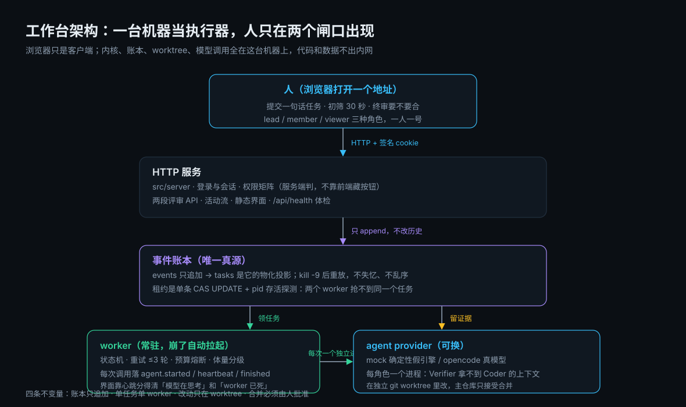
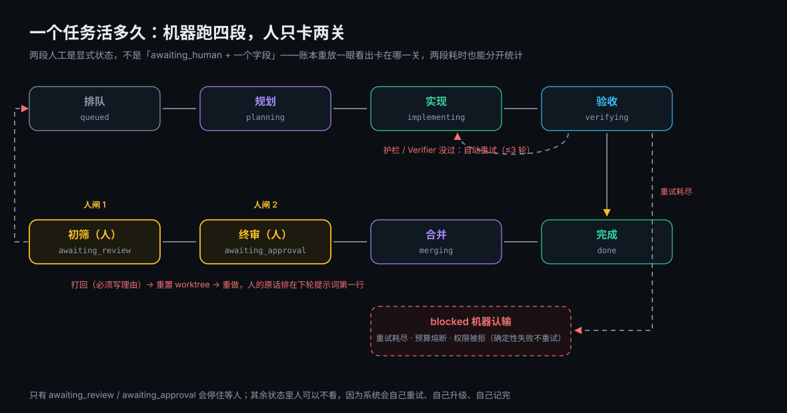
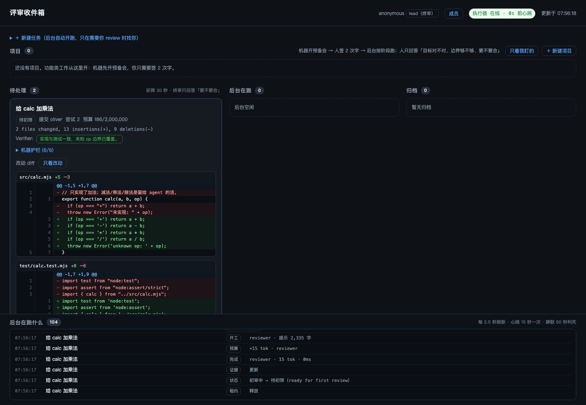

# 工作台 · Workbench（Web 版）

**一个「AI 团队分工写代码、人只负责 review」的后台编程执行器。**

你提交一句话任务 → 后台自动拆解、写代码、跑真测试、独立复核 → 只把两个不可逆的时刻推到你面前：

1. **这件事做对了吗**（初筛，30 秒）
2. **要不要合**（终审，一句话）

其余全部自动重试、自动升级、自动归档、自动合并 —— 人不是值班员，是签字的人。

`Node.js ≥ 22.5` · `MIT` · `npm test` 82 项全过 · 默认 `mock` 引擎零成本 · 一台机器当 runner，其他人用浏览器

> 仓库分工：这里只有 **Web 版**（内核 + 服务端 + 浏览器界面）。macOS 桌面版（把同一套内核打包成 `.app`）在 [noOne-Oliver/workbench](https://github.com/noOne-Oliver/workbench)，两边**不共享任何文件**。

---

## 一、为什么需要它

AI 写代码的工具已经很多了，**能无人值守跑一天的很少**。绝大多数工具在你关掉终端的那一刻就失效了，因为它们缺的不是模型能力，是下面这些东西：

| 常见的崩法 | 为什么会崩 | 这里的做法 | 你怎么亲眼确认 |
| --- | --- | --- | --- |
| 重启后「任务去哪了」 | 状态存在内存/进程里 | **事件账本**只追加，`tasks` 只是物化投影，重启从事件重放（`src/core/ledger.mjs`） | `kill -9` 后再跑，事件流出现 `attempt.resumed`，不重复烧重试额度 |
| 「测试全绿」但其实没改对 | 只信模型自评、只跑一遍测试 | **四道确定性护栏**：真跑测试、比对用例/断言数、查同义反复、diff 规模 + **回归基线**（`src/runner/guards.mjs`） | 注入一条恒真断言，第一轮必被打回，第二轮才过 |
| 人在旁边当值班员 | 只有「实现中」一个状态，看不出是模型在想还是进程已死 | **活动流**：每次 agent 调用落 `agent.started / heartbeat / finished`，界面常驻「coder 正在跑 · 已 1m23s」 | 静默超时那句话自动变红「⚠ 90s 无事件，worker 可能已停」 |
| 两个人抢同一个任务 | 没有租约，谁都以为自己拿到了 | **租约**＝单条 CAS UPDATE + pid 存活探测（`src/core/lease.mjs`） | 同任务只会出现一次 `lease.acquired` |
| 「这是谁批的？」 | 共享口令，谁都能批任何事 | **一人一号** + 三角色权限矩阵 + 两段评审（`src/core/permissions.mjs`） | 打回不写理由直接 400；member 点批准回 403 |
| 一晚上烧掉一个月预算 | 没有预算概念，重试无上限 | **预算熔断** + 进实现前留验证余量 + **体量分级**少调几次（`src/core/sizing.mjs`） | `--budget 10` 入队，跑一轮即 `blocked`，不再花 token |

一句话：**它把「不可信的部分」（模型写的代码）四道确定性检查围起来，把「不可逆的部分」（合并）留给人。**

---

## 二、一张图看懂它怎么跑



四条不变量，缺一条就会退化成值班员：

- **账本只追加** —— 任何状态都能从事件重算，进程崩了不等于事实丢了。
- **单任务单 worker** —— 靠租约，不靠「大家注意别抢」。
- **改动只发生在 worktree** —— 每个任务一个独立工作树，主仓库在被批准前不动。
- **合并必须由人批准** —— 机器可以证明「测试过了」，证明不了「这是你要的东西」。

### 状态机（人只看得到两个闸门）



只有 `awaiting_review` 和 `awaiting_approval` 会停住等人（`blocked` 是「机器认输了，等人捞」）。
其余状态之间的每一次失败，都走同一条路：**带证据打回 → 重置 worktree → 重做**，最多 3 轮（`WB_MAX_ATTEMPTS`）。

---

## 三、六个好处（每条都有实测数字）

### 1) 人的时间被压到「读结论」这一步

卡片上直接给：按文件分组的 diff（双列行号、可只看改动）、**真跑过的测试清单**、六项护栏逐条结论、独立 Verifier 的裁决与上抛问题。真引擎整单实测：**初筛 2 秒 + 终审 2 秒**（任务 `t_mwrszckr0xwnk`，44.4 万 token、111 秒机器时间、护栏 6/6）。

「人只回答要不要合」不是口号，是界面设计：初筛只问三个问题（做的是不是这件事 / 范围能否接受 / 有没有遗留），终审只问一个（合不合）。

### 2) 假绿真的抓得住，不靠模型自觉

「测试跑绿 ≠ 改对了」。三条真实抓到的例子，全部下沉成**确定性检查**（模型没注意到也照抓）：

| 作弊手法 | 长什么样 | 谁抓的 |
| --- | --- | --- |
| 削弱测试 | 删测试文件、用例 4→1、断言 6→3 | `no_test_weakening` |
| 同义反复 | 实现是 `return Math.pow(a,b)`，测试写 `assert.equal(pow(2,.5), Math.pow(2,.5))` | `no_tautological_test` |
| 顺手改坏别人 | 原来能过的 4 条用例现在挂了 | `no_regression`（把 base 提交的树展开到临时目录，用同一条命令再跑一遍） |

假绿会被自动打回，重试到上限才升级给人。而重试这件事本身踩过两个坑、都堵上了：**不喂证据＝无脑重试**（现在把失败护栏 id + 证据原文 + 上一轮 diff 写进 coder 提示词），**不重置 worktree＝假装重试**（第二次之前 `git reset --hard` 回基线，否则 coder 看到上一轮代码会产出逐字节相同的 diff，白烧一整轮 token）。

### 3) 崩了自己回来，不靠人守着

- **任务级**：`kill -9` 后重启，从断点续跑，事件流出现 `attempt.resumed`（不重复计算重试次数）。
- **进程级**：`up` 起的是「被看护的 worker」，崩了按 1s→2s→4s…封顶 30s 退避自动拉起，跑稳 60s 计数清零（`src/core/supervisor.mjs`）。
- **僵尸进程**：父进程注入 `WB_PARENT_PID`，`kill -9` 外壳后内核自己收工，不会留下占着端口的孤儿。
- **卡死兜底**：认领到状态机不认识的状态 → 落 `run.stalled` 证据 + 转 `blocked`；连续 3 轮认领但状态/花费都没变也停到 `blocked`。绝不空转。

> 这条是真实事故换来的：一个旧 worker 认领了新状态 `awaiting_approval` 不认识，两小时空转写满 17GB 事件、86,864,540 条，最后 V8 自己 abort。现在「跑着旧代码」会直接在界面徽章上变红。

### 4) 成本减半，而且可预期


| 做法 | 效果 |
| --- | --- |
| **体量分级**：小改动跳过 lead/architect/reviewer，只花 coder + verifier 两次调用 | 同一套 5 单基准：平均 **482,743 → 230,630 token（−52.2%）**，机器时间 121 秒 → 49 秒 |
| **预算熔断**：超预算立刻 `blocked`，不再花一个 token | `--budget 10` 入队当场停 |
| **验证余量**：进实现前检查余量（默认留 25% 或 15 万） | 避免「写完实现、没钱验证」把钱和活一起扔掉 |
| **确定性分类**：体量由规则判（高危词 / 文件数 / 标题长度），不让模型自己声明 | 跑错了就是代码错了，跑完自动对账角色序列 |

真实开销量级（6 单混跑实测）：**small 约 21 万；normal 42~61 万；large 62 万 token**，平均一单约 126 秒机器时间。

### 5) 全过程看得见

状态徽章只告诉你「实现中」，分不清「模型在思考」和「worker 已死」——那又变成值班员。所以每次 agent 调用都落三条事件（开工 / 15 秒心跳 / 收工），界面底部常驻一条活动流，卡片上还有一句「**coder** 正在跑 · 已 1m23s」。


执行器本身也有心跳（每 5 秒写 `data/worker.json`，`/api/health` 免登录读），标题栏常驻「执行器 在线 · Ns 前心跳」，超过 20 秒变红「任务不会推进」。


### 6) 多人用同一个执行器，不打架

一台机器当 runner，其他人浏览器打开就行（不用装 app、不用碰终端）。身份是**一人一号**，不是共享口令：

| 角色 | 能做什么 | 不能做什么 |
| --- | --- | --- |
| member | 提交任务、领取初筛、打回自己领的任务 | 批准合并、改预算、加人 |
| lead | 上面全部，加终审批准合并、管理成员 | —— |
| viewer | 只看 | 一切写操作 |

- 口令用 `node:crypto` 的 scrypt 哈希存库，登录态是 HMAC 签名的 cookie（7 天）；**改口令或改角色会立刻踢掉旧会话**。
- **两段评审**：机器验证完先给成员初筛（30 秒），通过后才是 lead 终审。两段耗时分别落库（`review_seconds` / `approval_seconds`），初筛打回率长期为 0 就说明这一关该砍。
- **领取制**：任何 member 都能领某张初筛卡，领了锁 30 分钟，超时自动释放；lead 也能直接过（账本记 `waived`）。
- **自己提交自己批**：允许，但必须写理由，卡片标红、账本记 `self_approved` —— 统计得出来谁在给自己放水。
- **打回必须写理由**，原话会排进下一轮 coder 提示词第一行（优先级高于机器结论）。

---

## 四、界面长什么样




---

## 五、快速部署

三种路径，按你要的「真」程度选。**建议先走 A（30 秒）确认界面对不对，再走 B。**

### 路径 A：30 秒看效果（假引擎，零成本，不碰真模型）

只需要 Node.js ≥ 22.5。

```bash
git clone https://github.com/noOne-Oliver/workbenchweb.git && cd workbenchweb
npm run init                 # 建账本 + 初始化 demo 仓库
npm run enqueue -- --title "实现 calc 四则运算" --repo ./sandbox/demo
npm run worker               # 终端 2：后台一直跑（也可 --once 跑一轮）
npm run serve                # 打开 http://127.0.0.1:7317
```

默认引擎是 `mock`（确定性假引擎，专门用来验证流水线和护栏），不需要任何 API key、不花钱。
想看「假绿被打回」的完整链路：

```bash
WB_MOCK_SCENARIO=good WB_FAULT=tautology node scripts/demo-retry.mjs --fresh   # 4 秒
```

### 路径 B：团队内网正式用（5 分钟）

**1. 建工作区**（账本、worktree 目录、起始仓库 `demo/` 都在里面；幂等，重复跑不覆盖已有内容）

```bash
node src/cli.mjs workspace --dir ~/Workbench
```

**2. 一条命令起整套**（server + 被看护的 worker，崩溃自动拉起）

```bash
WB_ROOT=~/Workbench node src/cli.mjs up      # → http://127.0.0.1:7317
```

**3. 登录。** 首次启动会发现「没有能登录的账号」，自动建一个 `lead` 并在终端打印**一次性口令**：

```text
✓ 首次启动，已创建账号 lead（角色 lead）
  一次性口令：w56kq48XgqHK2YlD-aXXXnhq
  只显示这一次，请立刻用它登录并改口令
```

用名字 + 口令登录，然后在右上角「成员」里加人（member / lead / viewer），口令同样只显示一次。


**4. 把地址发给人。** 默认只监听 `127.0.0.1`；多人访问要开内网：

```bash
WB_HOST=0.0.0.0 WB_PORT=7317 WB_ROOT=~/Workbench node scripts/workbench.mjs start
```

启动器会把端口、日志、pid 都写在 `<工作区>/.wb/` 下，并打印本机与内网地址：

```text
✓ 工作台已启动
  工作区  /Users/you/Workbench
  引擎    mock
  进程    server=54675 worker=54676
  日志    ~/Workbench/.wb/server.log · ~/Workbench/.wb/worker.log

  本机    http://127.0.0.1:7317/
  内网    http://192.168.31.35:7317/   （同一 Wi-Fi 下的人用这个）
```

**5. 冒烟三件事**（部署完必做，两分钟）：

```bash
# ① 执行器活着吗（免登录，只返回 pid / 心跳 / 版本，不吐任务内容）
curl -s http://127.0.0.1:7317/api/health | jq '{ok, kernel: .kernel.version, worker: .worker.pid}'

# ② 后台真的在动吗（活动流）
curl -s 'http://127.0.0.1:7317/api/activity?limit=5' | jq '.live'

# ③ 页面上建一个任务，看它自己从 queued 走到 awaiting_review（mock 约 3 秒）
```

三个都对，这条流水线就是通的；剩下只是「换成真模型」。

### 路径 C：常驻（关终端、重启机器也不停）

交给 launchd（macOS）或 systemd（Linux）拉起同一条命令。macOS 用仓库里的启动脚本：

```bash
launchctl submit -l local.workbench.kernel -- /bin/bash scripts/run-kernel.sh
```

要开机自启，写一个 plist 到 `~/Library/LaunchAgents/local.workbench.kernel.plist`（`RunAtLoad=true`、`KeepAlive=true`），再 `launchctl load` 它。
Linux 对应的是一行 `systemd` unit：`ExecStart=/usr/bin/node <仓库>/src/cli.mjs up`、`Restart=always`。

日常运维四条：

```bash
npm run web          # start（已在跑只打印地址，不会起第二份）
npm run web:status   # 端口、两个进程、账本里各状态几个任务
npm run web:logs     # 跟 server + worker 日志（--follow）
npm run web:stop     # SIGTERM，8 秒不退再 SIGKILL
```

### 接真引擎（可选，会花 token）

默认 `mock` 只验证链路。要真写代码，得让 provider 调本机的 [opencode](https://github.com/sst/opencode)：

```bash
# 1) 把凭据放进工作区（凭据属于工作区，不进仓库、不进镜像）
cp -r /path/to/oc-home/. ~/Workbench/.oc/          # 里面应有 opencode.json / provider.env / node_modules
chmod 600 ~/Workbench/.oc/private/provider.env

# 2) 体检：几秒钟给结论，不会挂在那儿
WB_ENGINE=opencode WB_MODEL=<provider/model> node scripts/engine-smoke.mjs "只回复两个字 OK"

# 3) 起服务（预算按单任务给，真任务约 20~60 万 token）
WB_ENGINE=opencode WB_MODEL=<provider/model> WB_BUDGET=1000000 WB_ROOT=~/Workbench node src/cli.mjs up
```

### 部署检查清单

- [ ] `node -v` ≥ 22.5，`npm test` 全绿
- [ ] `/api/health` 返回 `ok` 且 `worker.pid` 在变
- [ ] 页面上建一个任务，能自己走到 `awaiting_review`
- [ ] 初筛通过 → lead 终审 → 合并后目标仓库真的出现 `wb: merge ...` 提交
- [ ] `kill -9` 掉 worker，4 秒后 `/api/health` 里 pid 变了（看护生效）
- [ ] 换真引擎后先跑**一单**，确认护栏 6/6 且 token 在预算内，再放开给人用
- [ ] 内网访问加 HTTPS 反代或 Tailscale（见「安全边界」）

### 部署常见坑

| 现象 | 原因 | 解法 |
| --- | --- | --- |
| 同事打不开，本机能开 | 只监听了 `127.0.0.1` | `WB_HOST=0.0.0.0`，并放行本机防火墙 |
| 登录后立刻被踢 | 有人改了你的角色/口令（`secret_version` 变了） | 重新登录，或 `node src/cli.mjs user passwd --name <你>` |
| 任务停在 `blocked` 说预算不足 | 真引擎单任务 20~60 万 token，预算给小了 | 加预算或人工接手；默认 `WB_BUDGET=1000000` |
| 护栏报「本机没有可用的 npm」 | 部署机没装 npm | 已自动退回 `node --test`（`WB_NO_NPM=1` 可强制） |
| 合并被拒：主仓库有未提交改动 | 保护你手上的活，不替你 stash | 先提交或清理，再重试合并 |
| 账本长得很快 | 见「事故复盘」：旧代码 + 新状态空转 | 升级后不会再有；发现 `run.stalled` 就查版本 |

---

## 六、实测数字（真引擎，不粉饰）

配置：opencode + `gptagent/deepseek-v4.1-flash`，同一套任务、同一台 M 系列 Mac。

### ① 真引擎整单（两段评审跑到底）

| 指标 | 值 |
| --- | --- |
| 任务 | `t_mwrszckr0xwnk`「给 calc 加乘法、除法与除零报错」 |
| 终态 | `done`，attempts=1（一次过） |
| token | 444,497 / 2,000,000 |
| 墙钟 | 111 秒（实现 + 验证 + 两段人工 + 合并） |
| 护栏 | 6/6 全绿（11 条用例真跑过，无回归、无削弱、无同义反复） |
| 改动 | 4 files changed, 55 insertions(+) |
| 初筛 / 终审 | 2s / 2s |
| 合并提交 | `fbe16d8 wb: merge 给 calc 加乘法、除法与除零报错` |

### ② 砍编排前后（同一套 5 单）

| 任务 | 旧：5 次调用 | 新：2 次调用 | 省 |
| --- | --- | --- | --- |
| slugify | 412,934 | 212,643 | 48.5% |
| median | 438,804 | 212,420 | 51.6% |
| range-bug | 463,427 | 238,872 | 48.5% |
| clamp | 466,648 | 264,167 | 43.4% |
| truncate | 631,901 | 225,049 | 64.4% |
| **平均** | **482,743** | **230,630** | **52.2%** |

5/5 仍一次过，护栏 6/6，合并后 main 上 27 个用例全绿；机器段 103~155 秒 → 39~57 秒。

### ③ small / normal / large 混跑 + 一次确定性降级

| 任务 | 体量 | 角色序列 | 尝试 | token | 机器秒 |
| --- | --- | --- | --- | --- | --- |
| slugify | small | coder → verifier | 1 | 210,118 | 48 |
| median | small | coder → verifier | 1 | 212,781 | 46 |
| merge-utils | normal | lead → coder → verifier → reviewer | 1 | 417,776 | 97 |
| truncate-long | normal | lead → coder → verifier → reviewer | 1 | 611,112 | 172 |
| refactor-range | large | lead → architect → coder → verifier → reviewer | 1 | 622,392 | 186 |
| fastpath-retry | small | coder → verifier →（被抓）→ lead → coder → verifier → reviewer | 2 | 829,423 | 205 |
| **合计** | — | 6/6 完成 | — | **2,903,602** | 墙钟 755 秒 |

**怎么读这些数（别读成「问题解决了」）**：

1. 一次过率 100% 只说明这 6 单在模型能力范围内，**不代表稳定**；失败率要拿「需求本身模糊」的活去跑才有意义。
2. 省钱来自「少调三次」，不是「调得更便宜」——单次调用仍是 6~17 万 token（harness + 工具往返 + 推理），继续压只能继续减次数。
3. 人工耗时 1~2 秒是**脚本代劳的下限**；真人读一单约 4 秒。真正该量化的是「证据包够不够判断」，这还没做。
4. 快路径把方案责任推给了 coder：没有上游拆解，它得一次想清接口形状。需求模糊的小改动跳过拆解可能反而多跑一轮（一轮 ≈ 21 万），所以这条规则该按**初筛打回率**持续校准。

复现：`npm run bench:real -- --fresh --tasks 6`（约 13 分钟、约 290 万 token）。

---

## 七、人到底要做什么

| 环节 | 谁做 | 花多久 | 输出 |
| --- | --- | --- | --- |
| 提交任务 | 任何 member | 20 秒 | 一句话标题 + 目标仓库 + 预算 |
| 机器干活 | 后台 | 1~3 分钟 | diff / 测试清单 / 护栏 / Verifier 裁决 |
| 初筛 | 领取的 member | 30 秒 | 过，或打回 + 理由 |
| 终审 | lead | 10 秒 | 合（合并），或打回 + 理由 |

三条铁律（写进 SOP，也写进代码）：

1. **Verifier ≠ Coder 的同一实例** —— 每个角色一次独立的进程调用，不给 coder 的内心独白；角色分离靠进程隔离，不靠提示词自觉。
2. **Agent 只上抛证据裁决不了的事** —— Verifier 自己判内容（同义反复、边界、非 ASCII 分隔符都是它主动上抛的）。
3. **人只回答「要不要合」，不回答「怎么写」** —— 想改写法就写一句打回理由，系统会带着它重做。

---

## 八、命令与环境变量

### 命令

```bash
node src/cli.mjs workspace --dir ~/Workbench     # 建工作区（幂等）
node src/cli.mjs init                            # 建库 + 建 demo 仓库
node src/cli.mjs enqueue --title "..." --repo <dir> [--owner <name>] [--budget 1000000]
node src/cli.mjs status [--id <task>]            # 任务与事件流
node src/cli.mjs rebuild                         # 从事件全量重建投影（自愈）
node src/cli.mjs run [--once] [--worker host:pid]# 跑 worker
node src/cli.mjs serve [--port 7317]             # 只起审阅服务
node src/cli.mjs up                              # 起整套（server + 看护着的 worker）
node src/cli.mjs user add|passwd|role|disable|enable|list
npm run web | web:status | web:logs | web:stop   # 进程管理
npm run demo:reset                               # demo 仓库恢复到种子状态
npm run docs:diagrams                            # 重新生成 docs/arch.svg · flow.svg · cost.svg
npm run shots                                    # 重新生成界面截图（需要本机 Chrome）
npm test                                         # 内核测试（82 项）
```

### 环境变量

| 变量 | 默认 | 说明 |
| --- | --- | --- |
| `WB_ENGINE` | `mock` | `mock` 假引擎；`opencode` 真引擎 |
| `WB_DB` | `data/ledger.db` | 账本路径 |
| `WB_TOKEN` | 空 | 脚本通道（curl/CI），记 `by=cli`；浏览器仍走名字 + 口令 |
| `WB_PORT` / `WB_HOST` | `7317` / `127.0.0.1` | 监听地址（多人用改 `0.0.0.0`） |
| `WB_MAX_ATTEMPTS` | `3` | 自动重试上限，超过转 `blocked` |
| `WB_MOCK_DELAY` | `0` | mock 每步延迟（演示慢任务/并发） |
| `WB_MOCK_SCENARIO` | `fakegreen` | `fakegreen` 第一轮故意刷绿；`good` 一次过 |
| `WB_MODEL` | 空 | opencode 用的模型 |
| `WB_OC_HOME` | `./.oc` | opencode 的 XDG 数据目录（必须可写） |
| `WB_BUDGET` | `1000000` | 单任务 token 预算 |
| `WB_ROOT` | 当前目录 | **数据根**：账本、worktree、起始仓库 |
| `WB_CODE` | 同 `WB_ROOT` | **代码根**：`web/` 从 `WB_CODE/web` 取（内核只读挂载时才需要分开） |
| `WB_NO_NPM` | 空 | 设 1 强制护栏走 `node --test` |
| `WB_HEARTBEAT_MS` | `15000` | agent 心跳间隔（界面「已跑 1m23s」靠它） |
| `WB_SILENT_MS` | `60000` | 多久没事件判「worker 可能已停」 |
| `WB_NO_BASELINE` | 空 | 设 1 关掉回归基线（无 git 历史时） |
| `WB_WORKER_BEAT_MS` | `5000` | worker 心跳写文件间隔 |
| `WB_WORKER_STALE_MS` | `20000` | 心跳超多久算断线 |
| `WB_PARENT_PID` | 空 | 外壳注入：ppid 变了内核自己收工，防孤儿 |

---

## 九、深入：几个关键实现

### 真引擎的四个坑（provider 里已全部兜住）

`WB_ENGINE=opencode` 时每个角色起一次独立的 `opencode run`（不 `--continue`），所以 Verifier 天然拿不到 Coder 的上下文。

| 坑 | 现象 | 兜法 |
| --- | --- | --- |
| 要写 `~/.local/share/opencode` | `attempt to write a readonly database`，沙箱里必崩 | 把 `XDG_DATA_HOME/CACHE/STATE` 指到工作区内的 `WB_OC_HOME` |
| 报错时**不退出** | 实测挂 13 分钟、stdout 0 字节 | 盯它自己的日志文件，命中限流/额度/鉴权字样立刻 SIGKILL |
| 空产出但 exit 0 | 看起来「干完了」，其实什么都没做 | 文本为空即判失败，绝不当成功 |
| 规划阶段读工作区被拒 | `PermissionRejectedError`，整轮只剩工具调用 → 被当空产出重试，57 秒烧 22.5 万 token | ① 生成 `permission-overlay.json` 只读放行工作区根 ② 权限拒绝归类为**确定性失败**直接 `blocked`，不再重试 ③ 原始事件落盘 `logs/fail-*.jsonl`（留最近 5 个） |

### 回归基线怎么比

`tests_pass` 回答「当前代码全绿吗」，`no_regression` 回答「跟 base 提交比，有没有原来绿的变红」：把 base 的树 `git archive` 展开到临时目录，用**同一条测试命令**再跑一遍，两边解析用例名单后对比。

| 结论 | 含义 |
| --- | --- |
| `regressions` | base 过、现在挂 → 直接 FAIL，列出用例名 |
| `fixed` | base 挂、现在过 |
| `added` / `removed` | 新增 / 删掉的用例（改名算 `removed`，不误报为回退） |
| 基线不绿 | base 里本就挂 N 条 → 不算这次回退，detail 如实写 |

> 这里也抓到过一个假绿：从 `node --test` 里再 spawn 一个 `node --test`，子进程继承 `NODE_TEST_CONTEXT=child-v8` 会**直接退出 0**，失败被当通过。修法是 `runSuite()` 里先 `delete env.NODE_TEST_CONTEXT`。

### 执行器崩溃事故（17GB 账本）

旧 worker 认领了两段评审上线后的新状态 `awaiting_approval`，它的 `switch` 没有对应分支 → 立刻 return → 释放租约 → 再挑同一个，两小时空转、86,864,540 条事件、磁盘写满、V8 abort。五层修复：**进程**（看护重启）/ **可见**（心跳 + `/api/health`）/ **界面**（标题栏在线状态）/ **卡死**（不认识的状态 → `run.stalled` + `blocked`）/ **版本**（心跳带版本，不一致徽章变红）。另加兜底：连续 3 轮认领但状态/花费无变化 → `blocked`。

---

## 十、安全边界（别踩）

- 默认 **HTTP 明文 + 名字口令**，只适合内网/同一 Wi-Fi。出公网请套 **Tailscale** 或 **nginx + HTTPS 反代**，别直接端口映射。
- 审计看事件里的 `actor`：`review.claimed` / `review.passed` / `human.decision` 分别记领取人、初筛人、批准人。`WB_TOKEN` 只是脚本通道，别发给人。
- 工作区里的 `.oc/private/provider.env` 是真模型凭据，别把工作区目录共享出去。
- **静态文件按路径段校验**（`resolveStatic()` 用 `relative(WEB, file)` 是否以 `..` 开头，而不是 `startsWith` —— 后者会把 `web-secret` 这种兄弟目录当成「在 web 里面」）。
- **登录有退避**：同名连错 5 次锁 60 秒，之后每次翻倍、封顶 10 分钟（第 6 次 429 + `Retry-After`，锁住期间正确口令也不放行）。计数在内存，重启清空——挡在线爆破，不挡分布式撞库。
- **前端不拼内联 `onclick`**：用户名只进 `data-*`，点击走事件委托（名字里带单引号也炸不出字符串）。
- 明确的缺口：没有 CSRF token（靠 `SameSite=Lax`）、没有 2FA。前提都是「先套反代」。

---

## 十一、它不做什么（故意的）

- 不做多租户/组织树（5 倍工作量）。先做「一台机器当 runner + 内网 + 一人一号」。
- 不做富 UI 编辑、不做代码内联批注：只有「合 / 不合 + 一句话理由」。
- 不做「跨仓库大重构」自动合并：large 任务会多一道 architect，但合并前仍需人批准。
- 不做公有云托管：它假定执行器跑在你信得过的机器上。

---

## 十二、目录

```text
src/core/     账本、事件、状态机、租约、工作区、活动流、体量分级、身份、权限、看护
src/runner/   worker 循环、SOP 提示词、护栏（含回归基线）、worktree、引擎 provider
src/server/   HTTP + 静态审阅界面 + 登录/权限/两段评审 API
web/          审阅收件箱（三栏 / 新建任务 / 按文件分组 diff / 测试清单 / 全屏原始输出 / 活动流）
sandbox/demo/ 演示用目标仓库（有真测试，能真跑）
tests/        内核测试（82 项）
scripts/      启动器、demo 重置与重试演示、引擎体检、真引擎基准、截图与配图
```

## License

[MIT](LICENSE) © 2026 noOne-Oliver
